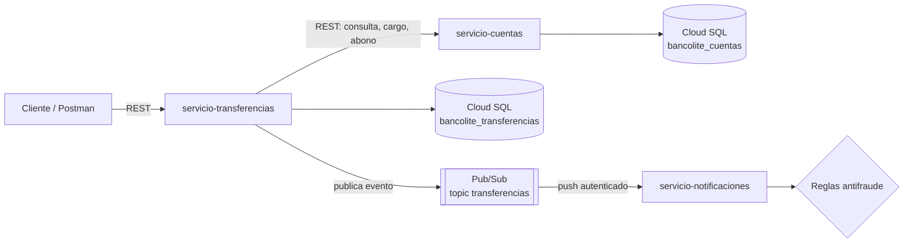

# BancoLite

Proyecto de práctica para aprender microservicios con **Spring Boot** y **Google Cloud Platform**.
Es un mini sistema bancario: cuentas, transferencias entre cuentas y notificaciones con reglas antifraude,
conectados con REST y con eventos en Pub/Sub, y desplegados en Cloud Run.

Lo hice para practicar cosas que se usan en sistemas financieros reales: no cobrar dos veces la misma
transferencia, qué hacer cuando un servicio falla a la mitad de una operación, y cómo manejar permisos y
contraseñas en la nube.

## Arquitectura



| Servicio | Puerto local | Qué hace |
|---|---|---|
| `servicio-cuentas` | 8081 | Alta de cuentas, consulta de saldo, cargos y abonos |
| `servicio-transferencias` | 8082 | Transferencias entre cuentas, idempotencia, reversa si algo falla y publicación de eventos |
| `servicio-notificaciones` | 8083 | Recibe los eventos de Pub/Sub, notifica y revisa reglas de fraude |

Cada servicio tiene su propia base de datos. Transferencias no toca la base de cuentas, le pide todo por HTTP.

## Tecnologías

- Java 21, Spring Boot 3.5 (Web, Data JPA, Validation, Actuator)
- MySQL 8, H2 para pruebas
- Spring Cloud GCP (Pub/Sub) y Cloud SQL Java Connector
- JUnit 5, Mockito, AssertJ, MockMvc
- Docker, Docker Compose y el emulador de Pub/Sub
- Google Cloud: Cloud Run, Cloud SQL, Pub/Sub, Secret Manager, Artifact Registry, IAM

## Endpoints

### servicio-cuentas

| Método | Ruta | Descripción |
|---|---|---|
| POST | `/api/cuentas` | Crear cuenta |
| GET | `/api/cuentas/{numeroCuenta}` | Consultar cuenta |
| POST | `/api/cuentas/{numeroCuenta}/cargo` | Restar saldo |
| POST | `/api/cuentas/{numeroCuenta}/abono` | Sumar saldo |

### servicio-transferencias

| Método | Ruta | Descripción |
|---|---|---|
| POST | `/api/transferencias` | Hacer transferencia (requiere header `Idempotency-Key`) |
| GET | `/api/transferencias/{id}` | Consultar transferencia |
| GET | `/api/transferencias?cuenta={numero}` | Últimos 20 movimientos de una cuenta |


### servicio-notificaciones

| Método | Ruta | Descripción |
|---|---|---|
| POST | `/pubsub/transferencias` | Lo llama Pub/Sub (push) |
| GET | `/api/alertas` | Alertas de fraude detectadas |


## Cómo correrlo en local

Requisitos: Java 21, Maven, Docker y MySQL 8.

1. Levantar el emulador de Pub/Sub (crea el topic y la suscripción solo):

   ```bash
   docker compose up -d
   ```

2. Variables de entorno para cuentas y transferencias:

   ```
   DB_PASSWORD=tu_password
   DB_USER=root
   ```

   Transferencias además necesita `SPRING_PROFILES_ACTIVE=local` para usar el emulador.

3. Correr los tres servicios (`AplicacionCuentas`, `AplicacionTransferencias`, `AplicacionNotificaciones`).
   Las bases se crean solas.


## Despliegue en Google Cloud

Un solo `Dockerfile` construye cualquiera de los servicios:

```bash
docker build -t us-central1-docker.pkg.dev/PROYECTO/bancolite/servicio-cuentas:v1 --build-arg SERVICIO=servicio-cuentas .
docker push us-central1-docker.pkg.dev/PROYECTO/bancolite/servicio-cuentas:v1
```


## Lo que me falta mejorar

-  Hacer privado `servicio-cuentas` y que transferencias lo llame con un token de identidad.
-  Pipeline con GitHub Actions: pruebas en cada push y despliegue automático a Cloud Run.
-  Patrón Outbox: si Pub/Sub está caído, el evento se pierde. Guardarlo en una tabla y publicarlo aparte lo resolvería.
-  Guardar alertas e ids procesados en Firestore para poder tener más de una instancia de notificaciones.
-  Dead letter topic para los mensajes que fallan varias veces.
-  Pruebas de integración con Testcontainers usando MySQL real en lugar de H2.

## Autor

**Dan Emerson Banda Almaraz**
[LinkedIn](https://www.linkedin.com/in/dan-banda-almaraz-dev/) · [GitHub](https://github.com/danbandaalmaraz)
