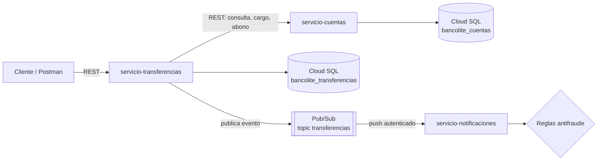

# BancoLite

Proyecto de práctica para aprender microservicios con **Spring Boot** y **Google Cloud Platform**.
Es un mini sistema bancario: cuentas, transferencias entre cuentas y notificaciones con reglas antifraude,
conectados con REST y con eventos en Pub/Sub, y desplegados en Cloud Run.

Lo hice para practicar cosas que se usan en sistemas financieros reales: no cobrar dos veces la misma
transferencia, qué hacer cuando un servicio falla a la mitad de una operación, y cómo manejar permisos y
contraseñas en la nube.

## Arquitectura



| Servicio | Puerto local | Qué hace |
|---|---|---|
| `servicio-cuentas` | 8081 | Alta de cuentas, consulta de saldo, cargos y abonos |
| `servicio-transferencias` | 8082 | Transferencias entre cuentas, idempotencia, reversa si algo falla y publicación de eventos |
| `servicio-notificaciones` | 8083 | Recibe los eventos de Pub/Sub, notifica y revisa reglas de fraude |

Cada servicio tiene su propia base de datos. Transferencias no toca la base de cuentas, le pide todo por HTTP.

## Tecnologías

- Java 21, Spring Boot 3.5 (Web, Data JPA, Validation, Actuator)
- MySQL 8, H2 para pruebas
- Spring Cloud GCP (Pub/Sub) y Cloud SQL Java Connector
- JUnit 5, Mockito, AssertJ, MockMvc
- Docker, Docker Compose y el emulador de Pub/Sub
- Google Cloud: Cloud Run, Cloud SQL, Pub/Sub, Secret Manager, Artifact Registry, IAM

## Endpoints

### servicio-cuentas

| Método | Ruta | Descripción |
|---|---|---|
| POST | `/api/cuentas` | Crear cuenta |
| GET | `/api/cuentas/{numeroCuenta}` | Consultar cuenta |
| POST | `/api/cuentas/{numeroCuenta}/cargo` | Restar saldo |
| POST | `/api/cuentas/{numeroCuenta}/abono` | Sumar saldo |

### servicio-transferencias

| Método | Ruta | Descripción |
|---|---|---|
| POST | `/api/transferencias` | Hacer transferencia (requiere header `Idempotency-Key`) |
| GET | `/api/transferencias/{id}` | Consultar transferencia |
| GET | `/api/transferencias?cuenta={numero}` | Últimos 20 movimientos de una cuenta |

Ejemplo:

```http
POST /api/transferencias
Idempotency-Key: tx-001
Content-Type: application/json

{
  "cuentaOrigen": "8228692466",
  "cuentaDestino": "6173286464",
  "monto": 100,
  "concepto": "Pago de comida"
}
```

| Respuesta | Cuándo |
|---|---|
| 201 | Transferencia `COMPLETADA` |
| 200 | La `Idempotency-Key` ya se había usado, regresa la misma transferencia |
| 400 | Datos inválidos o falta el header |
| 422 | `RECHAZADA` (sin fondos, cuenta no existe) |
| 502 | `REVERTIDA` o `FALLIDA` (falló el servicio de cuentas) |

### servicio-notificaciones

| Método | Ruta | Descripción |
|---|---|---|
| POST | `/pubsub/transferencias` | Lo llama Pub/Sub (push) |
| GET | `/api/alertas` | Alertas de fraude detectadas |

## Decisiones que tomé y por qué

**Dinero con `BigDecimal`.** Con `double` se pierden centavos (`0.1 + 0.2` no da `0.3`). Hay una prueba que lo comprueba.

**Bloqueo optimista con `@Version`.** Si dos operaciones mueven la misma cuenta al mismo tiempo, la segunda falla con 409
en lugar de sobrescribir el saldo.

**Idempotencia.** El cliente manda un `Idempotency-Key` en el header. Si la misma clave llega dos veces (por ejemplo,
porque se cortó el internet y la app reintentó), no se mueve dinero otra vez. Además la columna tiene `unique` por si dos
peticiones iguales llegan al mismo tiempo.

**Sin `@Transactional` en la transferencia.** El cargo y el abono son llamadas HTTP a otro servicio, y un rollback de la
base de transferencias no las deshace. Por eso la transferencia se guarda como `PENDIENTE` antes de mover dinero y, si el
abono falla después del cargo, se le regresa el dinero al origen (compensación, la idea del patrón Saga). Si también falla
la reversa, queda `FALLIDA` para revisión manual.

**Timeouts al llamar a cuentas.** 3 segundos para conectar y 5 para responder, para que transferencias no se quede colgado
si cuentas no responde.

**Errores con `ProblemDetail` (RFC 9457).** Todos los errores salen en el mismo formato estándar, con un manejador global
por servicio.

**Pub/Sub entrega "al menos una vez".** Notificaciones guarda los ids ya procesados para no notificar dos veces, y responde
2xx a mensajes que no se pueden leer para que Pub/Sub no los reintente para siempre.

**Seguridad en GCP.**
- Las contraseñas están en Secret Manager, no en el código ni en variables de entorno visibles.
- Los servicios corren con una cuenta de servicio propia con permisos mínimos: puede conectarse a Cloud SQL, leer solo
  el secreto `db-password` y publicar solo en el topic `transferencias`.
- `servicio-notificaciones` es privado: solo Pub/Sub puede llamarlo, con un token OIDC de una cuenta de servicio que solo
  tiene `run.invoker` sobre ese servicio.
- Cloud SQL no tiene redes autorizadas; solo se entra con el conector de Cloud SQL y permisos de IAM.
- Los contenedores corren con un usuario sin privilegios, no como root.

**`--no-cpu-throttling` en transferencias.** La publicación a Pub/Sub es asíncrona y termina después de responder.
Por defecto Cloud Run le quita la CPU al contenedor al responder, y el evento se quedaba sin enviar.

## Cómo correrlo en local

Requisitos: Java 21, Maven, Docker y MySQL 8.

1. Levantar el emulador de Pub/Sub (crea el topic y la suscripción solo):

   ```bash
   docker compose up -d
   ```

2. Variables de entorno para cuentas y transferencias:

   ```
   DB_PASSWORD=tu_password
   DB_USER=root
   ```

   Transferencias además necesita `SPRING_PROFILES_ACTIVE=local` para usar el emulador.

3. Correr los tres servicios (`AplicacionCuentas`, `AplicacionTransferencias`, `AplicacionNotificaciones`).
   Las bases se crean solas.

## Pruebas

```bash
mvn test
```

22 pruebas:
- `CuentaTest`: reglas de la entidad (saldo exacto, sin fondos, centavos).
- `CuentaControllerIntegracionTest`: la API completa con MockMvc y H2.
- `TransferenciaServicioTest`: todos los caminos de una transferencia con Mockito (completada, repetida, rechazada,
  cuentas caído, revertida y reversa fallida).
- `DetectorFraudeTest`: reglas de monto alto y de alta frecuencia.

## Despliegue en Google Cloud

Un solo `Dockerfile` construye cualquiera de los servicios:

```bash
docker build -t us-central1-docker.pkg.dev/PROYECTO/bancolite/servicio-cuentas:v1 --build-arg SERVICIO=servicio-cuentas .
docker push us-central1-docker.pkg.dev/PROYECTO/bancolite/servicio-cuentas:v1
```

Resumen de lo que configuré:

1. Artifact Registry para las imágenes.
2. Cloud SQL (MySQL 8) con una base por servicio y un usuario para la app.
3. Secret Manager con la contraseña de la base.
4. Cuenta de servicio `bancolite-run` con `cloudsql.client`, acceso solo al secreto y `pubsub.publisher` solo en el topic.
5. Cloud Run para los 3 servicios, con la contraseña inyectada desde Secret Manager.
6. Topic `transferencias` y suscripción push autenticada hacia notificaciones.

La conexión a Cloud SQL se configura solo con la variable `DB_URL`, sin cambiar código:

```
jdbc:mysql:///bancolite_cuentas?cloudSqlInstance=PROYECTO:us-central1:bancolite-mysql&socketFactory=com.google.cloud.sql.mysql.SocketFactory
```

## Capturas

**Servicios en Cloud Run**


**Evento recibido por Pub/Sub y alerta de fraude en los registros**


**Imágenes en Artifact Registry**


**Instancia de Cloud SQL**


## Lo que me falta mejorar

- [ ] Hacer privado `servicio-cuentas` y que transferencias lo llame con un token de identidad.
- [ ] Pipeline con GitHub Actions: pruebas en cada push y despliegue automático a Cloud Run.
- [ ] Patrón Outbox: si Pub/Sub está caído, el evento se pierde. Guardarlo en una tabla y publicarlo aparte lo resolvería.
- [ ] Guardar alertas e ids procesados en Firestore para poder tener más de una instancia de notificaciones.
- [ ] Dead letter topic para los mensajes que fallan varias veces.
- [ ] Pruebas de integración con Testcontainers usando MySQL real en lugar de H2.

## Autor

**Dan Emerson Banda Almaraz**
[LinkedIn](https://www.linkedin.com/in/dan-banda-almaraz-dev/) · [GitHub](https://github.com/danbandaalmaraz)
